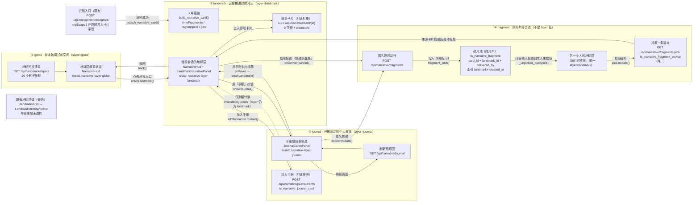

# A1 叙事动线图（Narrative Flow）

> 命题：**让每一张旅行照片，成为一次可被陌生人续写的空间叙事。**
> 本图只画代码里真实存在的节点与边；每个节点标注组件/路由/端点/表，每条边标注触发函数。
> 不含任何文化解释与虚构页面（文化内容最终解释权归人）。

## 1. 动线总览（30 秒版）

```
globe（未被讲述） → 点地标 → landmark（正在被讲述：卡片切面）
      → 加入手账 → journal（已沉淀：只读快照）
      → 匿名投递 → 碎片池（跨用户） → 陌生人在同一地标拾取（来源卡片摘要）
```

**口径说明（避免把"层"画成"流"）**

- ①②③ 是**同一个路由（`/`）里的三个 layer 状态值**（`useNarrativeStore.layer`，
  类型是 `"globe" | "landmark" | "journal"` 三值，没有第四值）。
- ④ **不是第四个 layer**，而是**跨用户异步流**：碎片写入 `ts_narrative_fragment`，
  另一个会话在同一个地标层里读取它。图上把 ④ 画成"池 + 另一个会话"，
  而不是画成第四条平行轨道——否则会把"同步状态切换"和"异步跨用户投递"混为一谈。

## 2. 动线图（Mermaid，可直接渲染为展板骨架）



## 3. 节点表（每个节点都可追溯）

| 节点 | 名称 | 类型 | 追溯路径 |
|---|---|---|---|
| N1 | 地球层叙事轨道 | 组件 | `frontend/src/features/narrative/NarrativeHud.tsx`（`layer==="globe"`，`data-testid="narrative-layer-globe"`） |
| N2 | 地标光点清单 | API | `GET /api/landmarks/spots` → `backend/api/landmarks.py::spots`；前端两处消费：`NarrativeHud.tsx`（叙事轨道）与 `GlobeApp.tsx`（地球光点） |
| N3 | 当前会话的地标层 | 组件 | `NarrativeHud.tsx` + `LandmarkNarrativePanel.tsx`（`layer==="landmark"`） |
| N4 | 叙事卡片 | API + 模型 | `GET /api/narrative/card/{landmark_id}` → `backend/api/narrative.py::get_card` → `NarrativeCard.as_card()`（`backend/apps/narrative/models.py`） |
| N5 | 卡片组装 | 服务 | `backend/services/narrative_service.py::build_narrative_card`（`_time_fragments` / `_rag_snippets` / `_geo`） |
| N6 | 加入手账 | API + 表 | `POST /api/narrative/journal/cards` → `narrative.py::add_card` → `ts_narrative_journal_card`（`unique_together=(user,card)`） |
| N7 | 手账层叙事轨道 | 组件 | `JournalCardsPanel.tsx`（`data-testid="narrative-layer-journal"`） |
| N8 | 刷新后取回 | API | `GET /api/narrative/journal` → `narrative.py::my_journal` → `narrative_service.journal_cards()` |
| N9 | 匿名投递动作 | API | `POST /api/narrative/fragments` → `narrative.py::deliver` → `narrative_service.deliver_fragment()` |
| N14 | 碎片池（跨用户） | 表 | `ts_narrative_fragment`（`card` / `landmark` / `delivered_by` 三外键；索引 `landmark,-created_at`）→ `backend/apps/narrative/models.py::NarrativeFragment` |
| N10 | 另一个人的地标层 | **运行时实例** | 同一 `layer==="landmark"`（`useNarrativeStore` 是模块级单例，第二个浏览器会话即第二个实例；不是独立代码实体） |
| N11 | 拾取一条碎片 | API + 表 | `GET /api/narrative/fragments/pick` → `narrative.py::pick` → `FragmentPickup`（`unique_together=(fragment,user)`）+ `fragment_payload()` |
| N12 | 识别入口（既有） | API | `POST /api/recognition/recognize` → `backend/api/recognition.py::recognize_sync` → `_attach_narrative_card()` |
| N13 | 既有地标详情（旁路） | 路由 + 组件 | `/landmarks/:id`（`frontend/src/App.tsx`）→ `LandmarkDetailWindow`（`frontend/src/pages/LandmarkDetail.tsx`）；与叙事层**无跳转**（`LandmarkDetail.tsx` 不引用 `useNarrativeStore`） |

## 4. 边表（每条边都有触发点）

| 边 | 用户动作 | 触发代码 | 数据落点 |
|---|---|---|---|
| N2→N1 | 打开地球页 | `useQuery(["landmarks","spots"])`（`NarrativeHud.tsx`；`GlobeApp.tsx` 同 key 复用） | 内存（光点清单） |
| N1→N3 | 点击地标入口 | `data-testid="narrative-landmark-entry"` → `useNarrativeStore.enterLandmark()` | 前端状态 `layer=landmark` |
| N3→N4 | 进入地标层 | `useQuery(["narrative","card",id])` | `ts_narrative_card`（无则现建） |
| N5→N4 | 卡片组装 | `build_narrative_card()` | `ts_narrative_card`（timeFragments/ragSnippets/geo） |
| N12→N5 | 识别成功 | `_attach_narrative_card()`（`api/recognition.py`） | 同上 + 识别响应字段 |
| N3→N6 | 点"加入手账" | `addToJournal.mutate()` → `POST /api/narrative/journal/cards` | `ts_narrative_journal_card`；**layer 仍停在 landmark** |
| N6⇢N3 | 加入手账后的回执 | `addToJournal.onSuccess` → `invalidateQueries(["narrative","journal"])`（只刷新手账计数，不切层） | 无写库（前端缓存失效） |
| N3→N7 | 点"手账"按钮 | `data-testid="narrative-open-journal"` → `showJournal()` | 前端状态 `layer=journal` |
| N7→N8 | **刷新页面** | `useQuery(["narrative","journal"])` 重新拉取 | 服务端 `ts_narrative_journal_card` |
| N8→N7 | 取回后渲染 | `journal_cards()` → `journal_payload()` | 内存（手账条目） |
| N7→N9 | 点"匿名投递" | `deliver.mutate()` → `POST /api/narrative/fragments` | `ts_narrative_fragment` |
| N3→N9 | 点"投递到此处"（就地投递） | `LandmarkNarrativePanel` 的 `data-testid="narrative-deliver"` → `onDeliver(card.id)` → `deliver.mutate()` | `ts_narrative_fragment` |
| N9→N14 | 投递写入碎片池 | `deliver_fragment()`（同用户同地标 ≤3，`fragment_limit()`） | `ts_narrative_fragment` |
| N14→N10 | 他人进入同一地标 | `_unpicked_queryset()`：`exclude(delivered_by=user)` + `exclude(已拾取)` | 内存（拾取池视图） |
| N10→N11 | 点"拾取碎片" | `pick.mutate()` → `GET .../pick?landmark_id=` | `ts_narrative_fragment_pickup` |
| N11→N3 | 拾取结果展示 | `picked` 状态 → `data-testid="narrative-picked-fragment"` | 内存（来源卡片摘要） |
| N7→N3 | 点手账卡片标题 | `onWake(landmarkId, name)` → `enterLandmark()`（`JournalCardsPanel`） | 前端状态 `layer=landmark` |
| N3→N1 | 点"返回" | `back()`（`stores/narrative.ts`） | 前端状态回退 |

> N13 不在边表内：它对叙事层没有触发路径（只开自己的浮窗），列在节点表仅作"旁路存在"的说明。

## 5. 这张图提出的结构关系（代码里不存在、需要被画出来的部分）

1. **同一 URL 上叠着三层**：`/` 这一个路由里，`globe / landmark / journal` 是 `useNarrativeStore`
   的三个状态值，不是三个页面。图上的横向移动在浏览器里是**零跳转**的；
   ④ 的跨用户流动则**必须**跨会话，二者不能画在同一条轨道上。
2. **刷新会重置视点，但不会重置内容**：`layer` 回到 `globe`，而 `ts_narrative_journal_card`
   里的卡片仍在（N7→N8→N7），这是"叙事沉淀"与"界面状态"的分离。
3. **两种"来源"合流到同一张卡片**：识别（N12）与地标现建（N4）都落到 N5，
   因此卡片既可以来自一张照片，也可以来自一次"我先看看这里有什么"。
4. **碎片池是"卡片引用 + 投递者"三层记录**：N14 记录 `card_id`、`landmark_id` 与投递者
   （投递者仅用于额度统计与"自投不可拾取"的排除）；匿名性是在**响应层**剥离的
   （`fragment_payload()` 不含投递者字段），库内仍可追溯。原始卡片不被复制。
5. **额度与唯一性是两个不同层级的闸门**：额度在"投递"（N9→N14，同地标 ≤3），
   唯一性在"拾取"（N11，同碎片 ≤1）；图上它们分居两条边，不能合并成一条。
6. **加入手账不切层**：N3→N6 之后仍停在 landmark（`N6⇢N3` 只刷新计数），
   进手账层是另一个显式动作（N3→N7）。这条"不跳转"的关系是展板上最容易画错的一处。

## 6. 证据（动线是否真的走得通）

| 证据 | 路径 | 结论 |
|---|---|---|
| S1 e2e 绿 | `e2e/narrative-journal.spec.ts` → `docs/competition/evidence/s1-e2e-green.log` | globe→landmark→journal→刷新仍在→逐层返回（`1 passed`） |
| S1 截图 | `docs/competition/evidence/s1-journal-{before,after}-refresh.png` | 刷新前后卡片一致 |
| S3 投递/拾取 | `tests/backend/test_s3_fragment_{delivery,pickup}.py` → `s3-functional-green.log` | 第 4 次 409 / 二次拾取 409 / 摘要字段（`6 passed`） |
| S3 手动 | `docs/competition/evidence/s3-manual-curl.log` | 真实 HTTP 200/200/200/409 + 拾取 200 + 二次拾取 409 |

## 7. 本图不包含什么

- 不含评论、审核、徽章、后台看板（属 §2 之外模块，本轮不改动）；
- 不含任何文化解释性文案（卡片文字来自文章库真实句，解释权归人）；
- N13（既有地标详情）只是旁路入口，**与叙事层无跳转**，因此不在动线里连线；
- ④ 的跨用户验证只有后端测试与手动 curl（两次真实 HTTP 会话），**没有**双浏览器 UI 证据——
  这是本图已知的证据缺口，不冒充已覆盖。
