# A4 技术可信度页（Technical Credibility）

> 用途：支撑"文化叙事不硬编、识别可核查、碎片机制可验证"的伦理主张。
> 纪律：本页**每条声明都附代码位置、测试名或数据文件路径**；不写无证据的性能/效果声明。
> 文化内容的最终解释权归人（SPEC §3.7）。

## 0. 图 1 · 跨层节点图（识别链 + 碎片链）

```mermaid
flowchart LR
  subgraph RECO["识别链（照片 → 卡片）"]
    I1["image（PNG/JPG）<br/>api/recognition.py::_validate"]
    I2["DINOv2 ViT-S/14<br/>services/retrieval_engine.py:49（本地权重 models/dinov2/）"]
    I3["FAISS 索引 351 条<br/>runtime/index/landmarks.faiss（539181 B）"]
    I4["注册图元数据 351 条 / 磁盘缺失 333 条<br/>runtime/index/landmarks.meta.json"]
    I5["并行装载并互校<br/>retrieval_engine.py（ntotal == len(meta)）"]
    I6["target_id → Landmark 解析<br/>解析失败即丢弃（recognition_service.py:61-67）"]
    I7["top-3 + 阈值 0.35<br/>_build_result<br/>confidence = 余弦相似度"]
    I8["响应 success=true<br/>候选为附加区块（非拒答）"]
    I9["MessageBar 候选列表<br/>frontend/src/features/qa/MessageBar.tsx:83"]
  end
  subgraph FRAG["碎片链（卡片 → 陌生人）"]
    F1["JournalCard<br/>ts_narrative_journal_card"]
    F2["deliver_fragment<br/>同用户×同地标 ≤3，第 4 次 409"]
    F3["NarrativeFragment<br/>anonymous=true，响应无 delivered_by"]
    F4["pick（_unpicked_queryset 排除自投）<br/>GET .../pick（无可用 404）"]
    F5["FragmentPickup<br/>unique_together=(fragment,user)"]
  end
  I1 --> I2
  I2 --> I3
  I2 --> I4
  I3 --> I5
  I4 --> I5
  I5 --> I6 --> I7 --> I8 --> I9
  I7 -->|"tripScape2 开启：_attach_narrative_card"| CARD["NarrativeCard<br/>ts_narrative_card"]
  CARD -->|"POST /api/narrative/journal/cards<br/>add_card_to_journal（get_or_create）"| F1
  F1 --> F2 --> F3 --> F4 --> F5
```



**读法**：左链解释"系统凭什么说这是某地标"（含阈值、候选、解析失败丢弃），右链解释
"叙事离开作者后凭什么只被一个人接住"（含匿名剥离点与唯一约束）。两条链在 `NarrativeCard` 上相接。
注意 I3/I4 是**并列装载并互校**（`ntotal == len(meta)`），不是上下游产出关系。

## 1. 识别置信度：定义、来源、自评、局限

### 1.1 数值语义与管线（全部可打开核对）

| 环节 | 实现 | 证据路径 |
|---|---|---|
| 图像 -> 向量 | DINOv2（ViT-S/14，权重本地 `models/dinov2/dinov2_vits14_reg4_pretrain.pth`） | `backend/services/retrieval_engine.py`（`DinoEmbedder.__init__` 内惰性 import torch 与 `torch.hub.load`） |
| 向量 -> 最近邻 | FAISS 索引（本地文件） | `runtime/index/landmarks.faiss`（539181 B ≈ 527 KB；`RetrievalEngine.__init__` 内 import faiss） |
| **confidence 的语义** | **L2 归一化向量的内积 = 余弦相似度**，取值 0–1，**不是概率** | `backend/services/retrieval_engine.py`（`sims = index.search(...)`，`best[tid] = float(sim)` 直接作为 confidence 返回） |
| 阈值 0.35 | 对**余弦值**设阈，不是"35% 概率门槛" | `backend/config/settings/base.py`（`RECOG_CONFIDENCE_THRESHOLD=(float, 0.35)`）；`recognition_service.py::_build_result` |
| 索引 -> 地标元数据 | 351 条注册图元数据；其中 333 条路径在磁盘已缺失 | `runtime/index/landmarks.meta.json`；`landmarks.manifest.json`（`count=351`） |

**关于"能否重建索引"（精确表述）**：`scripts/register_landmarks.py` 支持 `--list` 传自定义清单，
因此**不是绝对不能重建**；**不可行的是零参数默认入口**——默认清单 `scripts/db/register_images.json`
不存在，回退路径要求的 `data/train/` 也不存在，会在 `train_dir` 处 `FileNotFoundError`。
要重建必须自备一份指向现有图片的清单。

### 1.2 自评结果（跨批次自评，**不是泛化指标**）

评测协议（由 `scripts/recognition_selfcheck.py` 自动统计）：每个地标取 `data/<target_id>/`
下按文件名排序的第 1 张，共 **26 张**；其中 **3 张**（`HeavenTemple_1` / `Petra_1` / `Stonehenge_1`）
与索引注册图同名，**23 张是索引外照片**。**本节表是本页实测数字的权威出处**；
§0 图中的索引/元数据条数、§7 的耗时口径都是同一数据集的引用值，凡与本节冲突一律以本节为准。

| 指标 | 数值 |
|---|---|
| 评测图在索引内 / 索引外 | **3 / 23** |
| 索引注册图数 / 磁盘缺失路径 | **351 / 333** |
| top-1 命中 | **26 / 26**（`top1_rate=1.0`） |
| 置信度 min / median / max | **0.936256 / 0.999756 / 0.999984**（`statistics.median`） |
| 置信度分桶（<0.35 / 0.35–0.70 / ≥0.70） | **0 / 0 / 26** |
| 单图耗时（本机 CPU） | 全部 26 张：**min 59 / median 65 / max 2401 ms**（max 即首图）；其余 25 张：**min 59 / median 65 / max 71 ms** |
| 引擎装载耗时 | **3.4 s**（含 torch/faiss 首次导入与本地权重加载，不含下载） |

证据文件：`docs/competition/evidence/a4-recognition-selfcheck.json`
（26 行逐图明细：`image` / `in_index` / `top1` / `hit` / `confidence` / `top3` / `elapsed_ms`）。
复现：

```powershell
$env:DB_ENGINE='sqlite'
.venv\Scripts\python.exe scripts\recognition_selfcheck.py
```

> **局限**：每类只有 1 张图、无对抗样本；23/26 是索引外照片但仍属同一批采集风格。
> 26/26 不能外推为对任意照片的准确率；真实场景分布需要人工标注集，本轮未构造。

## 2. 低置信度候选机制（默认结果 + 附加候选，不是"拒答"）

```
RECOG_CONFIDENCE_THRESHOLD (默认 0.35，作用在余弦相似度上)
  -> _build_result(): low_confidence = confidence < threshold
  -> 命中时额外附带候选：candidates = 「top-3 中能解析到 ts_landmark 的部分」去掉 top-1
     （解析不到地标的 target_id 在 recognize_image 里被丢弃，故候选可能少于 2 条）
  -> 响应仍是 success=true，top-1 仍是默认结果；候选是"另外可能是什么"的附加区块
  -> 前端 MessageBar 在 low_confidence 且候选非空时把它渲染成可点列表
```

| 测试 | 断言 | 结果 |
|---|---|---|
| `tests/backend/test_a4_low_confidence_gate.py::test_low_confidence_returns_candidates` | 注入 `threshold-0.1`：`low_confidence=True`、候选非空、候选字段完整、候选置信度均 < 阈值 | PASSED |
| `tests/backend/test_a4_low_confidence_gate.py::test_high_confidence_has_no_candidates` | 注入 `threshold+0.5`：`low_confidence=False`、`candidates == []` | PASSED |

日志：`docs/competition/evidence/a4-low-confidence-green.log`（UTF-8，`2 passed`）。
说明：该测试核验的是**既有闸门**，不新增能力；替换的只有"模型输出"，判定与响应仍走真实服务与真实地标。

## 3. 文化内容边界：卡片文字从哪来

| 声明 | 证据 |
|---|---|
| `timeFragments` 的史料句来自文章库真实句（章节限于 历史沿革/概述/前言） | `backend/services/narrative_service.py::_time_fragments` |
| 句子无年份时 `year=null`，**不补写年份** | 同函数 `_extract_year` |
| 索引缺失时降级为地标简介原句（`source=db:ts_landmark.intro`） | 同函数降级分支 |
| `ragSnippets` 是真实混合检索结果（向量 + BM25 + RRF，K=60） | `backend/services/article_qa.py::ArticleIndex.search` |
| **最末级兜底是代码模板句，不是史料**：`f"{landmark.name}（尚无纪年史料登记）"`（`source=db:ts_landmark`） | `narrative_service.py` 兜底分支；`ragSnippets` 同构兜底为 `f"{landmark.name}"` |
| 数据底盘规模 | `runtime/index/qa_chunks.json`：144 chunks / 26 地标 / 8 类章节 |

> 诚实边界：模板句只在"无文章 + 无简介"时出现，它**是硬编码文案**，但内容是"没有史料"的
> 声明而非史料本身；展板上必须与语料句区分标注。本页不解释任何地标的历史含义。

## 4. 碎片：匿名投递与单次拾取

| 机制 | 实现 | 证据 |
|---|---|---|
| 投递额度（同**用户** × 同地标 ≤ 3） | 计数与限额判定在 `deliver_fragment`（按 `delivered_by + landmark` 计数后抛 409）；`fragment_limit()` 只读配置返回上限 | `backend/services/narrative_service.py::deliver_fragment` / `fragment_limit`；`tests/backend/test_s3_fragment_delivery.py` |
| 单次拾取（同碎片 ≤ 1 次/人） | 数据库唯一约束 + 服务层显式拒绝 | `backend/apps/narrative/models.py::FragmentPickup`（`unique_together=(fragment, user)`）；`pick_fragment_by_id`；`tests/backend/test_s3_fragment_pickup.py` |
| 匿名性（响应不含投递者） | `fragment_payload()` 固定 `anonymous=true`，无投递者字段 | `backend/services/narrative_service.py::fragment_payload`；`test_s3_fragment_pickup.py`（断言无 `deliveredBy/user`） |
| 随机拾取排除自投 | `_unpicked_queryset` 排除 `delivered_by=user`；**按 ID 拾取不排除**（`pick_fragment_by_id` 无此校验） | `narrative_service._unpicked_queryset` / `pick_fragment_by_id`；`test_own_fragment_is_not_pickable`（仅覆盖随机拾取） |
| 只能投递手账中的卡片 | 服务层校验 `JournalCard` 存在 | `narrative_service.deliver_fragment`（403）；`test_deliver_rejects_card_not_in_journal` |
| 手动复核 | 真实 HTTP 序列 | `docs/competition/evidence/s3-manual-curl.log` |

## 5. 声明 → 证据索引（供评审逐条抽查）

| 声明 | 证据类型 | 路径 |
|---|---|---|
| 识别用 DINOv2 + FAISS 检索式管线 | 代码 | `backend/services/retrieval_engine.py` |
| confidence = 余弦相似度（非概率），阈值 0.35 作用其上 | 代码 | `backend/services/retrieval_engine.py`、`backend/services/recognition_service.py`、`backend/config/settings/base.py` |
| 索引规模与磁盘缺失情况 | 数据文件 | `runtime/index/landmarks.manifest.json`、`landmarks.meta.json` |
| 自评数字（唯一出处） | 实测报告 | `docs/competition/evidence/a4-recognition-selfcheck.json` |
| 低置信度附带候选（顶部仍返回 top-1） | 测试 + 代码 | `tests/backend/test_a4_low_confidence_gate.py`、`recognition_service.py` |
| 卡片字段集与真实响应对齐 | 快照 | `docs/competition/A2-card-schema.snapshot.json` |
| 时间碎片/检索片段不编造（含模板兜底说明） | 代码 + 数据 | `narrative_service.py`、`runtime/index/qa_chunks.json` |
| 同用户×同地标 ≤ 3 条投递 | 测试 | `tests/backend/test_s3_fragment_delivery.py` |
| 单次拾取唯一 / 匿名投递 | 测试 + 表约束 | `tests/backend/test_s3_fragment_pickup.py`、`apps/narrative/models.py` |
| 叙事三层流程可走通 | e2e | `e2e/narrative-journal.spec.ts`、`docs/competition/evidence/s1-e2e-green.log` |
| RRF 分数上界 2/61（非概率） | 代码 + 数据 | `backend/services/article_qa.py`、`A2-card-schema.snapshot.json` |

## 6. 已知缺口（真正的缺口）

| # | 缺口 | 影响 | 是否本轮处理 |
|---|---|---|---|
| K1 | 前端 `JournalEditWindow` 调 `/api/uploads/image`，后端未挂载该路由（升级前既有） | 用户上传手账图会 404；叙事卡片 `photo` 回退地标百科图 | 否（超出 §2 范围，见 A3 `known_gaps` K1） |
| K2 | `ts_narrative_*` 未接既有审核流（`ts_journal.status`） | 叙事层内容没有 pending/approved 审核状态 | 否（属既有治理链路职责，A3 B6） |
| K3 | **服务层未校验"卡片所属地标 == 投递地标"** | 跨地标投递当前可行（`s3-manual-curl.log`：源卡片 landmarkId=1 投到 landmark 8 得 200）；前端只传卡片自身 landmarkId，属 UI 约定而非实现约束 | 否（§2 未要求该校验） |
| K4 | 地标现建的卡片 `confidence=0.0` | 前端显示"置信 0%"，代表"未识别，不宣称确信" | 设计如此，A2 M4 已注明 |

## 7. 口径声明与"本页不声称"的内容

- **自评非泛化**：26 张里 23 张在索引外、每类 1 张、无对抗样本；不得把 26/26 写成准确率。
- **耗时为实测记录**：3.4 s 装载、首图 2401 ms、其余 59–71 ms 均为本机事实记录；不作性能承诺。
- 不声称识别在真实场景的准确率（未构造人工标注集）。
- 不声称并发/吞吐指标。
- 不声称文化解释的正确性（只保证"无数据不编"，并如实标注模板兜底句）。
- 不声称审核治理已覆盖叙事层（K2 明示缺口）。

## 8. 本页的写法纪律

| 允许写 | 禁止写 |
|---|---|
| "在本机对自评集，top-1 全部命中（具体数字以 §1.2 为准）" | "识别准确率 100%" |
| "RRF 分数有理论上界，实测可触及（数值见 §1.2 与快照）" | "检索效果业界领先" |
| "低于阈值时附带候选列表，但仍以 top-1 为默认结果" | "低置信度会拒答（没说什么算低）" |
| "碎片在 (fragment, user) 上唯一" | "保证不会被重复拾取（没有约束）" |
| "confidence 是余弦相似度" | "置信度就是概率" |
